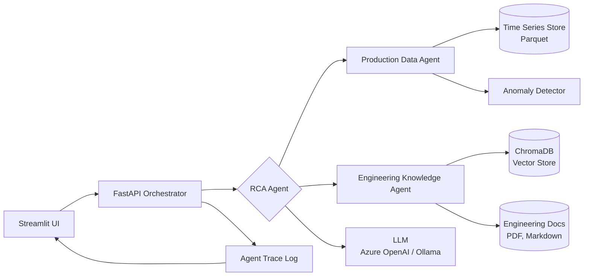

# Upstream AI Copilot

> An agentic AI reference implementation for upstream oil and gas operations. Demonstrates how a Cognite Data Fusion style data foundation, retrieval augmented generation over engineering documents, and orchestrated LLM agents combine to deliver explainable root cause analysis on production data.

[](https://github.com/coolbdey/upstream-ai-copilot/actions)
[](https://www.python.org/downloads/)
[](https://opensource.org/licenses/MIT)

---

## Why this exists

Upstream operators have set a public goal of deploying hundreds of AI agents across operations by 2026, built on top of industrial data platforms such as Cognite Data Fusion and Cognite Atlas AI. The hard part is not the model. The hard part is the architecture beneath it: the contextualised OT data, the engineering knowledge graph, the access boundaries, and the orchestration layer that lets agents reason across all of it without hallucinating.

This repository is a working reference of that architecture in miniature. It uses synthetic production sensor data and synthetic engineering documents so it can run locally on any laptop, with the same patterns that scale to a real industrial AI platform.

## What it does

The system takes a natural language question from a production engineer, for example:

> Why did the discharge pressure on Compressor C-101 drop on Tuesday evening, and what should I check first?

It then:

1. Pulls the relevant time series from the contextualised production data store.
2. Detects the anomaly and quantifies it.
3. Retrieves relevant engineering documentation, equipment data sheets, and maintenance history through retrieval augmented generation.
4. Runs a root cause analysis agent that produces a structured, citation-backed answer with suggested next checks.
5. Returns the answer through a Streamlit interface, with the underlying chart, the retrieved documents, and the agent trace visible for trust and audit.

## Architecture



### Component summary

| Component | Role | Technology |
|---|---|---|
| Time Series Store | Synthetic OT sensor data, contextualised by asset and tag | Parquet via pandas |
| Vector Store | Embeddings of engineering documents | ChromaDB local mode |
| Production Data Agent | Queries sensors, runs anomaly detection | LangChain tool agent |
| Knowledge Agent | Retrieves and grounds answers in documents | LangChain retriever |
| RCA Orchestrator | Multi-step reasoning, chains the agents | LangGraph |
| API | Stateless orchestrator endpoint | FastAPI |
| UI | Conversational interface with trace visibility | Streamlit |
| LLM Provider | Reasoning engine, swappable | Azure OpenAI, OpenAI, or Ollama |

## Quick start

### Prerequisites

* Python 3.11
* Either an Azure OpenAI / OpenAI API key, or Ollama running locally with a model such as `llama3.1:8b`
* Docker, optional, for the containerised path

### Local setup

```bash
git clone https://github.com/coolbdey/upstream-ai-copilot.git
cd upstream-ai-copilot

python -m venv .venv
source .venv/bin/activate    # On Windows: .venv\Scripts\activate

pip install -r requirements.txt

cp .env.example .env
# Edit .env with your LLM provider keys

# Generate synthetic data and build the vector index
python scripts/generate_synthetic_data.py
python scripts/build_index.py

# Launch the UI
streamlit run src/ui/app.py
```

Open `http://localhost:8501` and ask a production engineering question.

### Docker

```bash
docker compose up --build
```

The Streamlit UI is exposed on port 8501 and the FastAPI orchestrator on port 8000.

## Project layout

```
upstream-ai-copilot/
├── src/
│   ├── agents/             # LangChain and LangGraph agents
│   ├── rag/                # Embedding, indexing, retrieval
│   ├── ingestion/          # OT data ingestion and contextualisation
│   ├── api/                # FastAPI orchestrator
│   ├── ui/                 # Streamlit conversational UI
│   └── core/               # Config, logging, LLM client factory
├── data/                   # Synthetic time series data
├── docs/                   # Synthetic engineering documents
├── scripts/                # Data generation, index build, evals
├── tests/                  # pytest unit and integration tests
├── notebooks/              # Exploration notebooks
├── .github/workflows/      # CI pipeline
├── ARCHITECTURE.md         # Architecture decisions and trade-offs
├── ROADMAP.md              # Where this would go next in production
├── docker-compose.yml
├── Dockerfile
├── requirements.txt
├── .env.example
└── README.md
```

## Example queries

The system is seeded with synthetic data for three pieces of equipment on a fictional offshore platform: a gas compressor C-101, a separator V-201, and an export pump P-301. Try queries such as:

* What is the trend of suction pressure on C-101 over the last seven days?
* Compare the running hours of P-301 against its scheduled maintenance interval.
* Summarise the maintenance history for V-201 and flag any recurring issues.
* The discharge temperature on C-101 spiked at 14:00 yesterday. What are the most likely causes?

## Engineering principles applied

This project deliberately mirrors patterns from production industrial AI deployments.

* **Contextualised data first.** No agent runs against raw sensor names. The ingestion layer attaches asset hierarchy, equipment type, and unit of measure to every tag, the same way Cognite Data Fusion contextualisation works.
* **Grounded answers.** The knowledge agent never returns content the underlying documents do not support. Every claim is traceable to a source chunk.
* **Auditable agent traces.** Every orchestrator run writes a structured trace of which tools were called, with which inputs, and what the LLM concluded. This is what makes AI usable in a regulated environment.
* **Pluggable LLM provider.** The same code runs against Azure OpenAI, OpenAI, or a local Ollama model. This protects the project against vendor lock and supports air-gapped deployments.
* **Boring deployment.** FastAPI, Streamlit, Docker, GitHub Actions. Nothing exotic. The novelty is in the reasoning, not the plumbing.

## What this is and is not

This is a reference implementation built to demonstrate an architecture pattern. It is intentionally compact, uses synthetic data, and runs on a laptop.

It is not a production system. A production deployment would substitute the synthetic Parquet store for Cognite Data Fusion or a similar industrial data platform, would harden the API with proper authentication, and would add the governance, lineage, and human in the loop controls that any agent acting on operational data must have.

The architecture and the boundaries, however, are deliberately the same.

## Author

**Bidyendu Dey** — Senior Enterprise Architect, Cloud and AI Platforms. Twenty years across upstream energy, financial services, and industrial sectors. Embedded delivery at Equinor Move2Cloud and Aker BP Yggdrasil Digital. TOGAF, Azure Solutions Architect Expert, SC-100 Cybersecurity Architect Expert. Based in Sandnes, Norway.

[LinkedIn](https://linkedin.com/in/bidyendu) | [GitHub](https://github.com/coolbdey)

## License

MIT. See [LICENSE](LICENSE).
